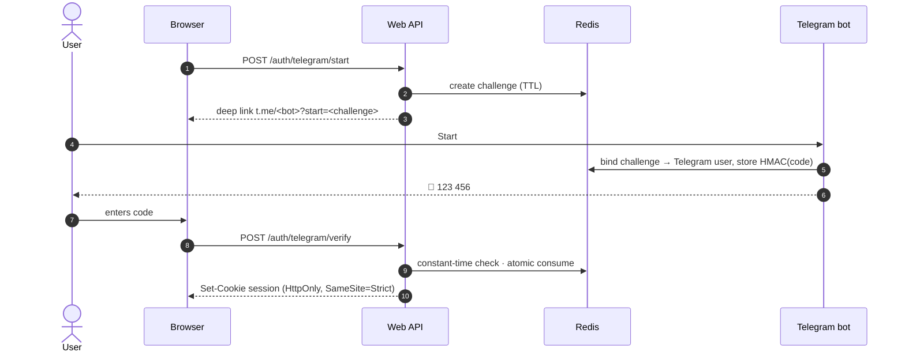

# telegram-otp-auth

[](https://github.com/HOFFMAN-ALTERNATIVE/telegram-otp-auth/actions/workflows/ci.yml)


Passwordless website login with one-time codes delivered by your own Telegram bot. A small FastAPI module and an aiogram 3 bot, with a written [threat model](docs/threat-model.md) and tests for each property in the table below: 30 tests, 89 % coverage (gate 85 %), `mypy --strict`, plus a full login flow against a real Redis in CI.

## Why

Telegram is already on your users' phones and works well as a second channel. Home-made OTP flows are routinely broken in the same ways: codes stored in plain text, no attempt limits, reusable codes, race conditions, IP limits that trust a spoofable header. This is a reference implementation that gets those details right.

The trade-off: login depends on Telegram being reachable and on the user having an account there. It is a good second channel and a poor only channel for audiences without Telegram.

## Security properties

| Property | How |
|---|---|
| Codes never stored | only `HMAC-SHA256(secret, challenge_id:code)` is kept in Redis |
| CSPRNG codes | `secrets.randbelow`, no modulo bias, configurable length (6–10) |
| Short-lived | challenge TTL 5 min, delivered code TTL 2 min |
| Single use | atomic compare-and-delete Lua script; of concurrent verifies, exactly one wins |
| Attempt limit | 5 wrong codes per challenge → challenge burned |
| Brute-force lockout | 10 failures/hour per Telegram account → 15 min lock |
| Rate limits | per IP (start, verify) and per Telegram user (codes/hour), resend cap per challenge |
| Constant-time compare | `hmac.compare_digest` |
| Challenge binding | first Telegram account to claim a challenge owns it, so links can't be hijacked |
| Session | random 256-bit token, HttpOnly + Secure + SameSite=Strict cookie, server-side revocation |
| Web hardening | strict CSP (no inline JS), `no-store`, `nosniff`, `frame-ancestors 'none'`, XFF trusted only for configured hops |
| Privacy-friendly logs | events only (`login.success`, `account.locked`…), never codes, tokens or IPs |

All values are tunable in [`.env.example`](.env.example).

## How it works



## Quick start

```bash
git clone https://github.com/HOFFMAN-ALTERNATIVE/telegram-otp-auth.git && cd telegram-otp-auth
cp .env.example .env     # SECRET_KEY, BOT_TOKEN, BOT_USERNAME
docker compose --profile bot up -d --build
open http://127.0.0.1:8000     # demo login page
```

## Integrating into your app

```python
from otp_auth.web.app import create_app       # mount as a sub-app…
app.mount("/login", create_app())

from otp_auth.service import OTPService        # …or use the service directly
svc = OTPService(redis, settings)
challenge = await svc.start(client_ip)
outcome, code, _ = await svc.issue_code(challenge.id, telegram_user_id)   # in your bot
result = await svc.verify(challenge.id, user_input, client_ip)            # in your API
```

| Endpoint | Result |
|---|---|
| `POST /auth/telegram/start` | `200` challenge + deep link · `429` |
| `POST /auth/telegram/verify` | `200` + cookie · `400` wrong (attempts_left) · `409` code not sent yet · `410` expired/used · `423` locked · `429` |
| `GET /auth/me` | `200 {telegram_user_id}` · `401` |
| `POST /auth/logout` | `204` |

## Examples

- [`examples/llm-web-search`](examples/llm-web-search): a local Ollama model with web-search tool calling via self-hosted SearXNG.

## Development

```bash
python -m venv .venv && . .venv/bin/activate && pip install -e ".[dev]"
pytest              # 30 tests, fakeredis with Lua, coverage gate 85%
ruff check . && mypy otp_auth tests
```

CI additionally runs the full HTTP flow against a real Redis in Docker and `pip-audit` on the resolved dependencies.

## Container image

Multi-arch (amd64/arm64) images are published to GitHub Container Registry on every release:

```bash
docker pull ghcr.io/hoffman-alternative/telegram-otp-auth:latest
```

## Design decisions

- [ADR 0001](docs/adr/0001-hmac-digest-for-codes.md): store `HMAC(secret, challenge_id:code)`,
  not the code and not a bcrypt hash. With a 10^6 space the secret is the protection.
- [ADR 0002](docs/adr/0002-redis-with-atomic-consume.md): all state in Redis with TTLs, and a
  Lua script that checks and deletes in one step, so a code is used exactly once.
- [ADR 0003](docs/adr/0003-opaque-server-side-sessions.md): opaque session tokens in Redis
  instead of JWTs, so logout is a real revocation.

## Limits

- Redis is required and holds all state. If Redis is down, logins fail rather than fall back, and `/healthz` returns an error.
- Rate limits and lockouts live in one Redis; there is no cross-region coordination.
- The bot uses long polling. For webhook delivery you need to add the endpoint yourself.
- Sessions are opaque cookies stored in Redis. Revocation is per session; there is no "log out everywhere" UI.

Security notes and reporting: [SECURITY.md](SECURITY.md).

## License

MIT, see [LICENSE](LICENSE).
