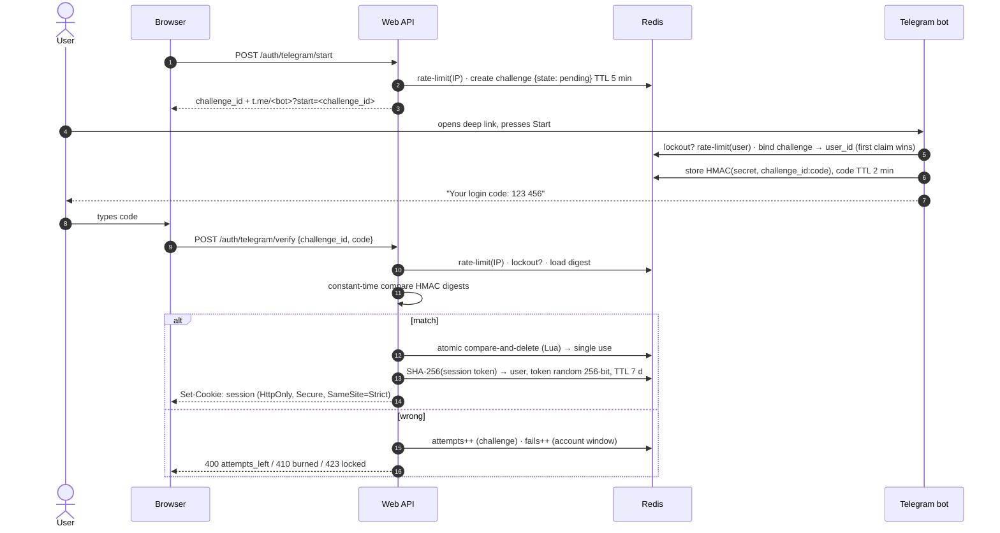

# Threat model

**Asset:** the ability to obtain a session for a Telegram account on the website.
**Trust boundaries:** browser ↔ web API (HTTPS), Telegram ↔ bot, web API/bot ↔ Redis (private network).
**Assumptions:** HTTPS terminates at a trusted reverse proxy; Redis is not internet-reachable; the Telegram account itself is not compromised.

## Login flow

## STRIDE analysis

| # | Threat | Vector | Mitigation |
|---|---|---|---|
| S1 | **Spoofing** — guess a code | online brute force of 10⁶ space | ≤ 5 attempts per challenge, then challenge is burned; ≤ 10 failures/hour per account → 15 min lockout; per-IP verify rate limit. Success probability per challenge ≈ 5·10⁻⁶ |
| S2 | Spoofing — hijack someone's challenge | attacker sends victim's deep link to own bot chat first | challenge is bound to the **first** Telegram account that claims it; the session is issued for that account, never the victim's |
| S3 | Spoofing — phishing relay | attacker shows a victim his own deep link, victim forwards code | inherent to all OTP schemes; bot message warns "never share"; short code TTL; code is only valid for the challenge it was minted for |
| T1 | **Tampering** — replay a used code | resend verify request | atomic compare-and-delete in Lua; concurrent requests: exactly one wins (tested) |
| T2 | Tampering — reuse a digest | DB/Redis leak | digest = HMAC-SHA256(server secret, challenge_id:code): useless without secret, bound to one challenge |
| R1 | **Repudiation** | — | structured logs of events (`challenge.started`, `code.issued`, `login.success/failed`, `account.locked`) **without** codes, tokens or IPs |
| I1 | **Information disclosure** — code at rest | Redis dump | only HMAC digests are stored; codes exist in memory just long enough to be sent |
| I2 | Info disclosure — timing | measure compare time | `hmac.compare_digest` on fixed-length digests |
| I3 | Info disclosure — session theft via XSS | script reads cookie | HttpOnly cookie, strict CSP (`default-src 'self'`), no inline scripts |
| I4 | Info disclosure — user enumeration | — | flow never asks for a username; responses don't reveal account existence |
| D1 | **Denial of service** — spam challenges / codes | scripts | per-IP start limit, per-user code limit (10/h), ≤ 3 codes per challenge, TTLs on every key, Redis `maxmemory` + `volatile-ttl` |
| D2 | DoS — lock out a victim | attacker guesses on victim's challenge | attacker cannot obtain a challenge bound to the victim (S2), so lockout can only be triggered on one's own account |
| E1 | **Elevation** — CSRF on verify/logout | cross-site POST | `SameSite=Strict` cookie, JSON body; CSP `frame-ancestors 'none'` |
| E2 | Elevation — spoofed client IP to dodge limits | forged `X-Forwarded-For` | XFF honoured only for `TRUSTED_PROXY_COUNT` hops (default 0) |

## Residual risks & recommendations

- **Compromised Telegram account** = compromised login. For high-value accounts add a second factor (WebAuthn).
- Rotate `SECRET_KEY` by deploying a new key; outstanding codes (≤ 2 min) simply fail.
- Put the API behind HTTPS and set `COOKIE_SECURE=true`.
- Keep Redis private (no published port) and enable `requirepass`/ACLs in production.
- Rate limits are fixed-window; for very high traffic consider sliding windows.
