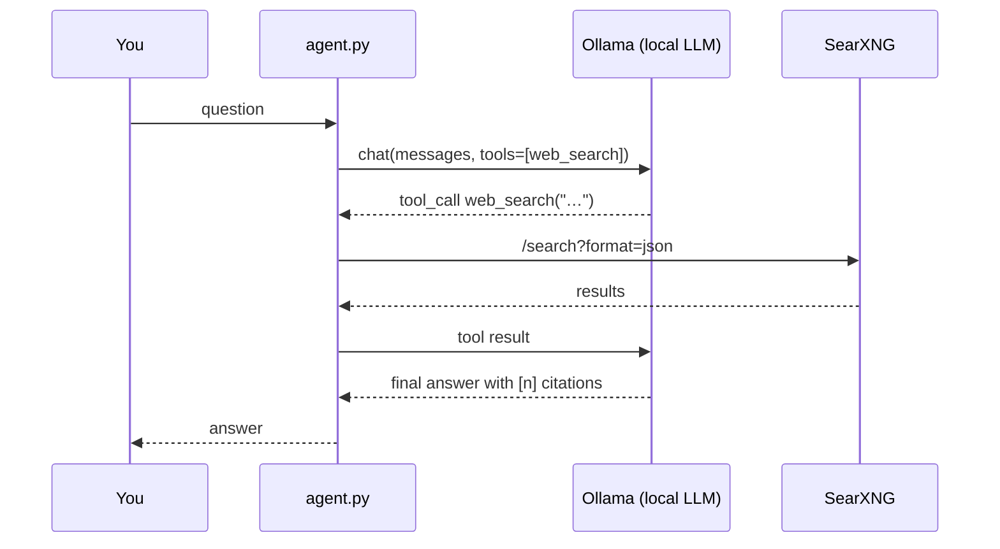

# Example: local LLM with web search (tool calling)

A ~120-line agent loop: an Ollama model decides when to call a `web_search` tool, the tool queries a self-hosted
[SearXNG](https://github.com/searxng/searxng) metasearch instance, and the model answers with cited sources.



```bash
docker compose up -d
docker compose exec ollama ollama pull qwen2.5:7b   # any tool-capable model
pip install httpx
python agent.py -v "What changed in the latest Linux kernel release?"
```

Tests (mocked HTTP): `pytest -q`.
